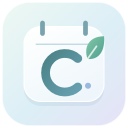
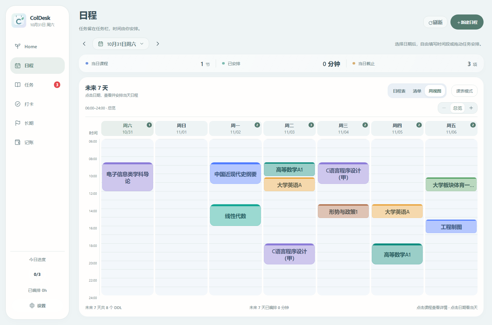
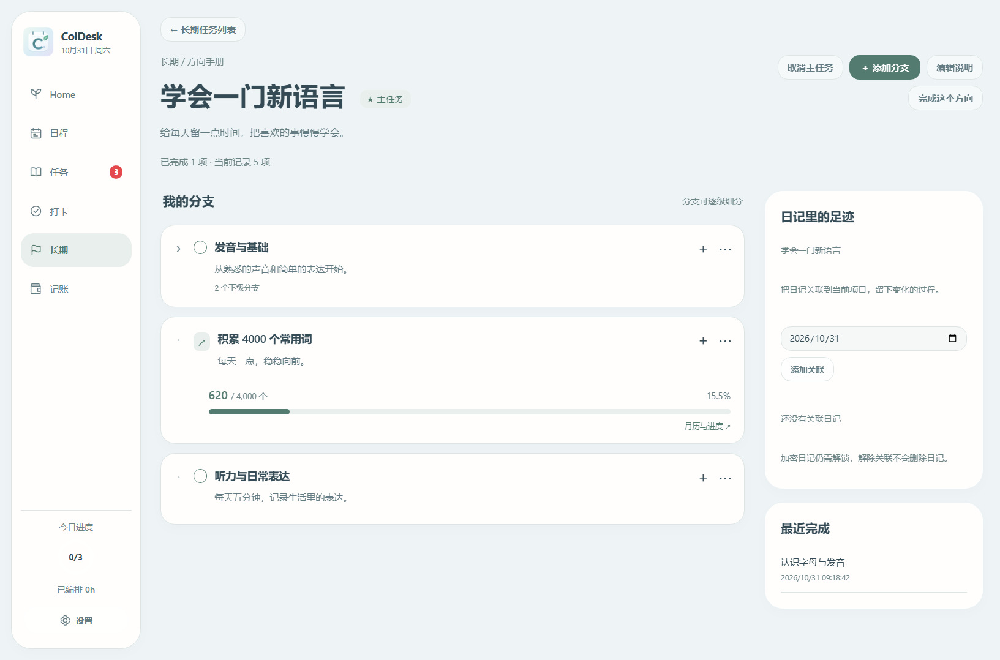

<p align="center"></p>
<h1 align="center">ColDesk</h1>
<p align="center">把日程安排好，把心事写下来，把小小的坚持留下来。</p>
<p align="center">Windows 桌面应用 · 本地存储 · 玻璃悬浮窗 · MIT 开源</p>

ColDesk 将日程、任务、日记、长期目标、习惯打卡与记账放在一个应用里。主窗口用于整理日常，桌面悬浮窗和灵动岛模式用于查看当下安排与提醒。



## 下载与安装

前往 **[Releases](https://github.com/Wanzhou2606/ColDesk/releases)** 下载 Windows 安装包。需要 Windows 10/11 64 位，普通用户无需安装 Node.js 或开发工具。首次公开发布准备完成前，Releases 可能暂时为空。

首次打开有入门引导，可在 **设置 → 使用帮助 → 重新查看引导** 再次观看。卸载保留本机个人记录。未数字签名的安装包可能出现 Windows 信誉提示，请核对下载来源与发布页的 SHA-256 校验文件。

## 可以做什么

| 功能 | 说明 |
| --- | --- |
| 日程与课表 | 日视图、清单、周视图；自定义时间范围与缩放；课程节次时间轴；查看和安排其他日期 |
| 任务 | 截止日期日历、详细内容、紧迫程度、置顶；拖入日程，自由设置多段时间；新任务不会自动填满日程 |
| 桌面组件 | 玻璃悬浮窗、贴边抽屉和灵动岛；可拖动、悬停展开，显示临期任务和提醒 |
| home 日记 | 月历手写封面、天气、心情、照片与附件；可选密码保护；按日期范围导出 TXT、Word 或原始照片 |
| 长期目标 | 方向手册、可逐级添加的分支、量化目标与进度条、每日进度月历、主任务与日记关联 |
| 自律打卡 | 自选图标、月历与完成率、归档记录、每日名言 |
| 记账 | 支出、分类与预算、日/周/月统计，支持关联日记 |
| 个性化 | 清新主题、课程淡彩、自定义字体与图标、导航顺序及默认启动页；中文、英语、日语 |



快捷键：`Ctrl+Alt+T` 快速添加任务，`Ctrl+Alt+D` 显示或隐藏桌面组件。

## 导入课程

- 在 **设置 → 课程与排程** 导入或删除当前课表。删除前完整备份，保留任务、日记等个人记录。
- 支持杭电官方订阅链接的手动读取、预览与确认。链接可能包含个人访问凭证，请勿公开。
- 也可复制识别提示词，让自己使用的 AI 将课表图片转成 JSON，再粘贴校验导入。
- 导入后请与原课表核对；目前不会在后台自动同步订阅。

## 数据与隐私

- 业务记录保存在本机，Windows 默认数据目录为 `%APPDATA%\coldesk`。
- 新用户不携带开发者的课表或个人记录。源码内的课表已匿名化，仅用于预览和测试。
- 启动时滚动备份，删除课表前另建专用备份。可在 **设置 → 数据** 打开备份文件夹。
- 密码保护的日记在本机加密；导出的 TXT、Word 和照片不加密，请自行保管。
- 每日名言及主动导入课表会访问对应网络服务。可选同步和助手另需配置，应用并非承诺完全离线。
- 可选助手集成不包含任何账号或连接凭证，见 [可选集成](docs/INTEGRATIONS.md)。

## 开发运行

开发环境：**Node.js 24、pnpm 11.28.5、Windows 10/11 x64**。首次安装需要联网。

```powershell
git clone https://github.com/Wanzhou2606/ColDesk.git
cd ColDesk
pnpm install --frozen-lockfile
node node_modules/electron/install.js
pnpm dev
```

```powershell
pnpm typecheck      # 主进程、共享逻辑与界面类型检查
pnpm test           # 单元、数据层与启动测试；使用独立配置
pnpm build:only     # 仅生成 out/，不安装应用
pnpm audit:public   # 检查待提交文件中的个人配置和常见凭证
pnpm dist:win       # 检查、构建并生成 Windows 安装包
```

`pnpm build` 在普通贡献者电脑上只构建。自动覆盖安装仅在维护者明确创建且与当前机器匹配的 `developer.local.json` 下启用。详见 [开发说明](docs/DEVELOPMENT.md)。

## 结构与平台状态

```text
src/main/        Electron 主进程、数据库、日记与提醒
src/preload/     主窗口和组件的受限调用接口
src/renderer/    React 页面与桌面组件
src/shared/      日程、课表、目标和统计的共享逻辑
scripts/         构建、测试、图标生成与发行检查
docs/            开发、集成与发布说明
mobile/          移动端实验代码
android/         Android 实验工程
```

当前优先维护 Windows 桌面版。移动端处于实验阶段，不代表与桌面版功能对齐；Android 构建另需 Java、SDK 和本机工具链，不包含个人签名文件。

## 反馈与参与

欢迎提交 [Issue](https://github.com/Wanzhou2606/ColDesk/issues) 或 Pull Request。请附版本、复现步骤和脱敏截图，**不要上传日记数据库、订阅链接、密码或凭证**。参与方式见 [CONTRIBUTING.md](CONTRIBUTING.md)，安全问题见 [SECURITY.md](SECURITY.md)。

## 许可证与素材

代码及本仓库原创 ColDesk 图标采用 **[MIT License](LICENSE)**。第三方依赖遵循各自许可证，见 [THIRD_PARTY_NOTICES.md](THIRD_PARTY_NOTICES.md)。公开版使用原创日历与叶片图标，不包含早期个人使用的人物贴图。
